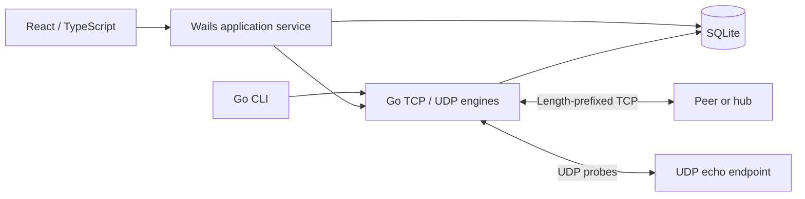

# Architecture
The domain boundary is a node: it may host a TCP listener and also connect as a client. A dedicated hub is the same listener used by several clients. A direct file transfer targets the receiving peer's listener. UI and CLI share the Go packages.

Each TCP connection has one reader. A mutex serializes writes to a chat connection. The server bounds active handlers and closes tracked sockets before waiting during shutdown. File transfers use separate connections, so a large upload does not occupy a chat stream.

Incoming files are written to generated temporary names. The receiver checks length and digest, syncs/closes, then renames to a unique generated filename. SQLite completion follows file commit; a history failure removes the just-created file. This is not a cross-resource atomic transaction; crash reconciliation remains a documented risk.

Transport packages know no UI concepts. Persistence failures are surfaced instead of being silently labeled successful. Progress is transient; completed actions and raw experiment records are durable.

See PROGRESS.md for implemented versus planned components.
